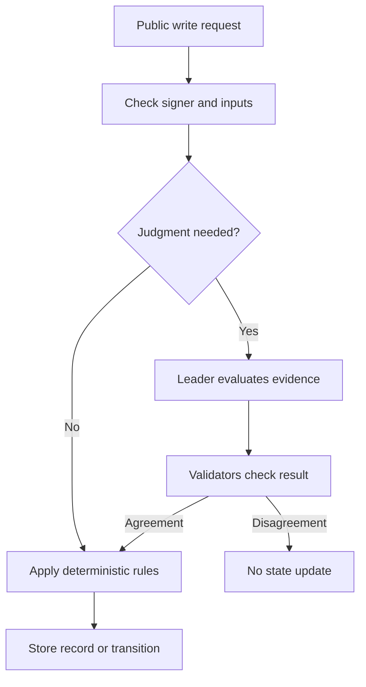

# How a decision reaches contract state

OpenFieldMap illustrates the boundary. The model judges whether an open-data column matches a canonical definition. A validated `MATCH` allows the proposal's signer to activate it. From then on, `normalize()` applies a predefined integer multiplier to the values a caller supplies. Comparing documentation, authorizing an active mapping, and converting a measurement are three distinct operations.

DonationAllocation uses the same boundary for an eligibility decision. Activation instead reserves units, and completion moves those units to either distributed or available. The capacity invariant is checked through the remaining, reserved, and distributed counts.
